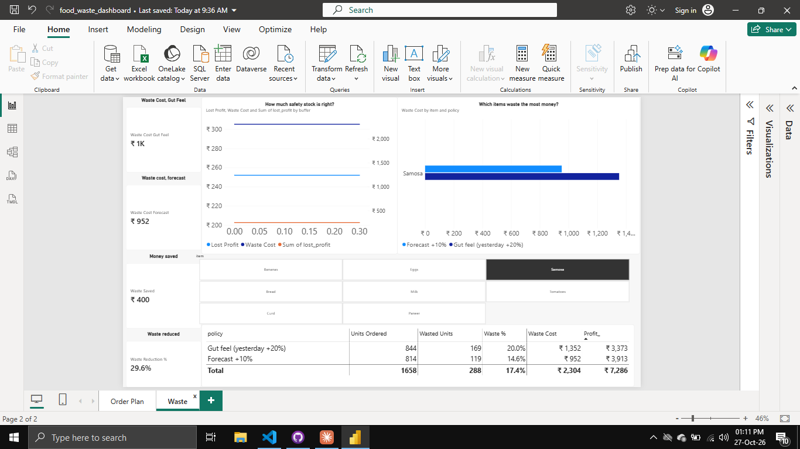
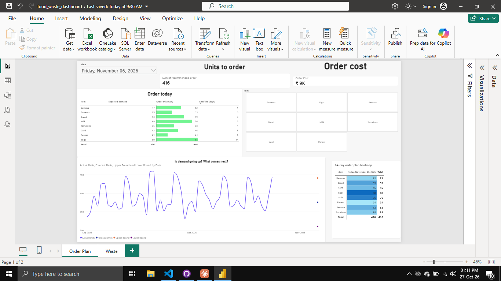

# Food Waste Forecast: Order the Right Amount, Waste Less

A demand-forecasting project for a small shop. Python predicts how much of each item will sell over the next 14 days, a simulation estimates how much food is thrown away under different ordering rules, and Power BI turns it into an "order today" plan and a waste dashboard.




## The problem
Small shops order perishable items by gut feeling. Order too much and food is thrown away. Order too little and sales are lost. Shelf life makes it harder: a samosa lasts a day, eggs last two weeks.

## The solution
1. **Forecast** daily demand for each item (weekday pattern plus trend).
2. **Simulate** the shop's stock day by day (shelf life, oldest stock sold first) under two ordering rules.
3. **Compare** the money lost to waste and missed sales.
4. **Show** the result in Power BI: what to order, and how much the forecast saves.

## Headline result (simulated data, last 14 days)

| | Gut feel (yesterday's sales + 20%) | Forecast + 10% buffer |
|---|---|---|
| Units wasted | 275 | 119 |
| Waste % of units ordered | 4.2% | 2.0% |
| Waste cost | ₹3,736 | ₹952 |
| Profit | ₹36,689 | ₹39,575 |

The forecast approach cut simulated waste cost by about **75%** against a simple rule of thumb.

**Read this honestly:**
- All data is **simulated** (8 items, 1 Jan to 24 Oct 2026, patterns I built in: weekly cycle, weekend boost, slow growth, random noise).
- The saving depends on the gut-feel rule I chose. A more careful shopkeeper would do better than "yesterday + 20%".
- It covers only 14 days, so treat the figures as an illustration, not a yearly estimate.
- The safety buffer matters: total loss was lowest at about 5% to 10%, and rose quickly above 15%.

## Forecast accuracy
- Baseline: average of the same weekday over the last 4 weeks. MAE = 5.56 units per item per day.
- Model (Prophet, or fallback): MAE = 5.39, about 3% lower..
- The model clearly beat the baseline on Milk and Bread, was about equal on Samosa, Curd, Bananas, Tomatoes and Paneer, and was worse on Eggs. I used the Prophet forecast for all items because it was slightly better overall, but for most items the difference is within the day-to-day randomness, so a simple weekday average would be almost as good.

Daily sales have randomness that no model can predict, so a small improvement over a good baseline is a realistic result.

## Tools
- Python 3.12: pandas, numpy, matplotlib, scikit-learn, Prophet
- VS Code with Jupyter notebooks
- Power BI Desktop: DAX measures, date table, star-shaped data model
- Claude (AI) as a tutor for explanations and debugging; I typed, ran and tested the code myself

## How it works

### 1. Data (Python)
Generated sales for 8 items with a different base demand, weekend boost, shelf life, unit cost and unit price for each.

### 2. Baseline and honest testing (Python)
Hid the last 14 days, predicted them, and compared with what happened. Splitting by time (not randomly) stops the model seeing the future.

### 3. Forecast (Python)
Fitted a model per item, compared it with the baseline, then refitted on all data to forecast the next 14 days with a lower and upper range and a recommended order (forecast + 10%).

### 4. Waste simulation (Python)
Each morning stock arrives; customers buy the oldest stock first; unsold stock past its shelf life is wasted; demand that stock can't cover is lost.

### 5. Dashboard (Power BI)
- **Order Plan page:** units and cost to order for a chosen day, "order today" table, actual vs forecast chart with range, 14-day order heatmap
- **Waste page:** waste cost by item and policy, savings cards, buffer trade-off chart

## Key DAX measures
```
Recommended Order = SUM(forecast[recommended_order])
Order Cost = SUMX(forecast, forecast[recommended_order] * RELATED(items[unit_cost]))
Waste % = DIVIDE([Wasted Units], [Units Ordered])
Waste Cost Gut Feel = CALCULATE([Waste Cost], waste_daily[policy] = "Gut feel (yesterday +20%)")
Waste Cost Forecast = CALCULATE([Waste Cost], waste_daily[policy] = "Forecast +10%")
Waste Saved = [Waste Cost Gut Feel] - [Waste Cost Forecast]
Waste Reduction % = DIVIDE([Waste Saved], [Waste Cost Gut Feel])
```

## Repository structure
```
food-waste-forecast/
├── raw_data/          Simulated sales and item details
├── notebooks/         forecast.ipynb (data, baseline, forecast, waste simulation)
├── clean_data/        Forecast, history and waste CSVs used by Power BI
├── screenshots/       Dashboard images
├── food_waste_dashboard.pbix
└── README.md
```

## How to run it
1. `pip install pandas numpy matplotlib scikit-learn prophet ipykernel`
2. Open `notebooks/forecast.ipynb` and run all cells in order. The forecast step can take a few minutes.
3. Open `food_waste_dashboard.pbix` in Power BI Desktop. If asked, point the data sources to the CSVs in `clean_data/` and `raw_data/`.

## What I learned
- A forecast is only useful if you test it on days it hasn't seen, and compare it with a simple baseline.
- Shelf life changes everything: a good forecast still wastes samosas, but barely affects eggs.
- More safety stock isn't free. The buffer trade-off is a real business decision.
- One-to-many relationships and a date table make Power BI visuals respond together.

## What I'd improve next
- Replace simulated data with a real retail dataset
- Add holidays, festivals and weather
- Forecast with item-specific buffers instead of one buffer for all
- Track real waste records instead of simulating them
